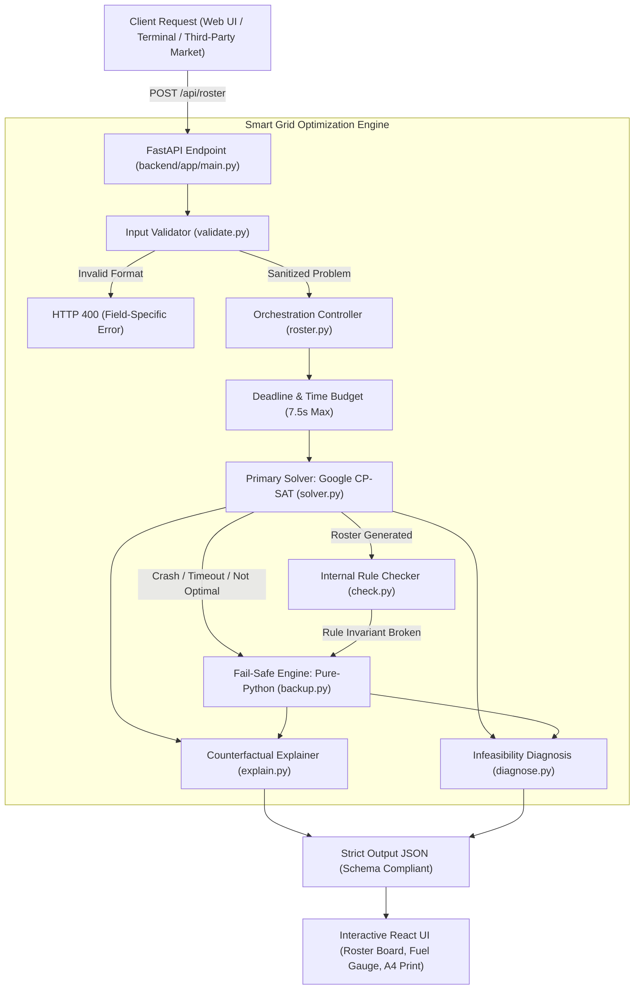

# ⚡ Smart Grid Scheduler — Who Stays On?

<div align="center">

[](LICENSE)
[](https://www.python.org/)
[](https://developers.google.com/optimization)
[](https://fastapi.tiangolo.com/)
[](https://react.dev/)
[](https://www.typescriptlang.org/)
[](https://vitejs.dev/)
[](https://www.docker.com/)

<p align="center">
  <b>A mission-critical generator roster & energy distribution optimizer built for acute load-shedding and microgrid constraints.</b><br/>
  Combines <b>Integer Linear Programming (Google OR-Tools CP-SAT)</b> with a <b>Pure-Python Heuristic Fail-Safe Engine</b> and an interactive, 100% offline web application.
</p>

[Key Highlights](#-key-highlights) •
[System Architecture](#-system-architecture) •
[Mathematical Modeling](#-mathematical-modeling) •
[Fail-Safe Fallback](#-dual-engine-resilience-fail-safe) •
[Quick Start](#-quick-start) •
[API Reference](#-api-reference)

---

</div>

## 🌐 The Problem Context

In acute load-shedding scenarios (e.g. urban commercial markets during grid shutdowns), power demand drastically outstrips emergency generator capacity and strict fuel reserves:

- **Demand:** 12 commercial shops demanding **~40 kW** combined.
- **Generator Limit:** **20 kW** single emergency generator (overloading trips the generator).
- **Fuel Budget:** Strictly **17.00 Litres** diesel for **7 outage hours** across 10 scheduling slots.
- **Critical Invariants:**
  1. **Mandatory Load:** Essential services (e.g. pharmacy fridge, bank ATM) must run 100% of outage hours.
  2. **Max Consecutive Dark:** No normal shop may sit in the dark for $\ge 3$ consecutive outage hours (max 2 hours dark in a row).
  3. **Non-Linear Fuel Table:** Diesel burns based on **aggregate load** per hour via discrete step tariffs, not per individual shop.

> ❌ **Why Greedy Fails:** Standard hour-by-hour greedy scheduling overspends diesel at noon on high-value shops, starving the critical evening rush ($17:00-20:00$) and violating consecutive dark-run constraints.  
> 
> ✅ **Our Paradigm:** We formulate the entire operating day as a **Unified Global Optimization Plan** solved in under 1.5 seconds.

---

## ✨ Key Highlights

- 🧠 **Globally Optimal Planning:** Solved using **Google OR-Tools CP-SAT** integer programming. Reaches proven global optimum (**186 total value** using exactly **16.40 L diesel**, leaving $0.60\text{ L}$ safety buffer).
- 🛡️ **Zero-Failure Dual Architecture:** Includes a pure-Python 3-phase heuristic fallback solver (`backup.py`) that executes in $<100\text{ ms}$ with $\approx 99\%$ optimality if CP-SAT times out or fails.
- 🔍 **Explainable AI / Decision Counterfactuals:** Every single disabled shop (`✗`) is paired with exact numerical reasoning (capacity overrun, fuel-tier jump, or counterfactual opportunity cost).
- 🏥 **Automated Conflict Diagnosis:** Detects infeasible inputs (e.g. budget deficit) and outputs actionable conflict breakdowns alongside a labeled **Best-Effort Roster**.
- 🔌 **100% Offline Single-Port Service:** FastAPI hosts both the REST API and the React SPA on a single port (`8000`), requiring zero cloud or internet connectivity at runtime.
- 🖨️ **Generator-Room Print View:** One-click A4 print template ready to be taped directly to emergency equipment control rooms.

---

## 🏗️ System Architecture



---

## 🧮 Mathematical Modeling

The whole day is formulated as an Integer Linear Programming (ILP) model:

### 1. Decision Variables
- $on[s, h] \in \{0, 1\}$: Binary variable indicating if shop $s$ is energized during outage slot $h$.
- $lvl[h, k] \in \{0, 1\}$: Indicator variable choosing active fuel slab $k$ for hour $h$ based on aggregated load.

### 2. Constraints

$$\sum_{s} \big(kW_s \cdot on[s, h]\big) \le \text{Capacity} \quad \forall h \in \text{OutageHours}$$

$$\sum_{h} \text{Fuel}_h \le \text{FuelBudget} \quad (\text{Calculated strictly in hundredths of a litre / centilitres})$$

$$on[s, h] = 1 \quad \forall s \in \text{MandatoryShops}, \forall h \in \text{OutageHours}$$

$$\sum_{t \in W} on[s, t] \ge 1 \quad \forall s \in \text{NormalShops}, \forall W \in \text{Windows of } (max\_dark + 1) \text{ hours}$$

### 3. Lexicographic 2-Stage Objective
1. **Primary Stage:** Maximize total revenue/value served over all outage slots:
   $$\max \sum_{h \in \text{Outage}} \sum_{s} \big(value[s, h] \cdot on[s, h]\big)$$
2. **Secondary Stage (Tie-Break):** Keeping the maximum value fixed, minimize total diesel burn:
   $$\min \sum_{h \in \text{Outage}} \text{Fuel}_h$$

---

## 🛡️ Dual-Engine Resilience (Fail-Safe)

To prevent unexpected unhandled exceptions (HTTP 500), the platform implements an autonomous 3-step fallback pipeline:

```
[ Step 1: Rotation ] ──▶ [ Step 2: Greedy Value-Add ] ──▶ [ Step 3: Local Search ]
  Satisfies hard rules     Consumes remaining diesel        Swaps & moves shops
  at cheapest fuel slots   by Value-per-Litre ratio         to reach ~99% optimum
```

| Failure Mode | Autonomous Safeguard |
|---|---|
| **OR-Tools missing or fails to load** | Pure-Python backup answers independently (`"solver": "backup"`) |
| **Native CP-SAT unhandled exception** | Caught by runtime try-except block; backup answers immediately |
| **Solver timeout on complex inputs** | Terminated at 7.5s deadline budget; best legal solution returned |
| **Internal rule check fails (`check.py`)** | Roster rejected instantly; legal backup roster dispatched |

---

## 📊 Benchmark & Arithmetic Verification

On the canonical 12-shop Shapla Shopping Complex benchmark dataset:

```
========================================================================================
Hour     Grid?    Load (kW)   Fuel Slab   Hourly Fuel (L)   Running (L)   Value Generated
========================================================================================
10:00    MAINS    --          Mains Off   0.00 L            0.00 L        0
11:00    MAINS    --          Mains Off   0.00 L            0.00 L        0
12:00    OUTAGE   14 kW       ≤ 14 kW     2.00 L            2.00 L        23
13:00    OUTAGE   14 kW       ≤ 14 kW     2.00 L            4.00 L        19
14:00    OUTAGE   20 kW       ≤ 20 kW     2.80 L            6.80 L        23
15:00    OUTAGE   14 kW       ≤ 14 kW     2.00 L            8.80 L        24
16:00    MAINS    --          Mains Off   0.00 L            8.80 L        0
17:00    OUTAGE   20 kW       ≤ 20 kW     2.80 L           11.60 L        34
18:00    OUTAGE   20 kW       ≤ 20 kW     2.80 L           14.40 L        37 (Peak!)
19:00    OUTAGE   14 kW       ≤ 14 kW     2.00 L           16.40 L        26
========================================================================================
TOTALS:  7 Outage Hours  |  Diesel: 16.40 L / 17.00 L  |  Value: 186  |  Violations: 0
========================================================================================
```

---

## ⚡ Quick Start

### Option A: 1-Click Launch (Windows)
Double-click `run.bat` or run:
```cmd
run_app.bat
```
*Automatically launches the FastAPI server and opens `http://localhost:8000` in your default browser.*

---

### Option B: Python Direct Run
```bash
# 1. Install dependencies
cd backend
pip install -r requirements.txt

# 2. Run API & UI (Single Port 8000)
python -m uvicorn app.main:app --host 0.0.0.0 --port 8000
```
Open **[http://localhost:8000](http://localhost:8000)** in your browser.

---

### Option C: Docker Compose
```bash
docker compose up --build
```
Access the screen at **`http://localhost:8088`** (or configured `APP_PORT`).

---

## 📡 API Reference

### Optimize Roster
`POST /api/roster`

Submits an energy situation JSON and returns the optimal schedule.

#### Sample Request:
```bash
curl -X POST http://localhost:8000/api/roster \
     -H "Content-Type: application/json" \
     --data-binary "@inputs/sample_input.json"
```

#### Sample Response (`200 OK`):
```json
{
  "status": "ok",
  "roster": [
    {
      "slot": 2,
      "hour": "12:00",
      "powered": ["pharmacy", "atm_booth", "photocopy", "tea_stall", "beauty_salon", "clothing"],
      "dark": [
        {
          "id": "tailor_jamal",
          "reason": "Adding its 4 kW lifts the hour 14→18 kW and fuel 2.00 L→2.80 L (+0.80 L) to earn 3; forcing it on would cut the day's best value 186→185 (−1)"
        }
      ],
      "load_kw": 14,
      "fuel_litres": 2.0,
      "fuel_running_litres": 2.0,
      "value": 23
    }
  ],
  "value_total": 186,
  "fuel_total_litres": 16.4,
  "dark_hours": { "pharmacy": 0, "atm_booth": 0, "tailor_jamal": 5 },
  "optimal": true,
  "solver": "cp-sat"
}
```

#### Status Codes:
- `200 OK`: Valid schedule generated (`status: "ok"`) OR cleanly diagnosed infeasible situation (`status: "infeasible"` + Best Effort).
- `400 Bad Request`: Invalid schema, missing fields, or dimension mismatch (`status: "invalid_input"` + `field`).
- `405 Method Not Allowed`: Invalid HTTP verb.

---

## 🧪 Testing & Verification Evidence

Run the full end-to-end test suite:
```bash
# Backend pytest suite (194 tests)
set PYTHONUTF8=1
python -m pytest backend/tests

# Frontend Vitest suite (11 tests)
cd frontend && npm test

# Independent Rule Auditor (0 shared code with solver)
python scripts/validate_output.py inputs/sample_input.json outputs/sample_output.json
```

Four documented verification defect cycles are preserved in `evidence/`:
1. `01_greedy_v0_broke`: Greedy algorithm diesel starvation reproduction & CP-SAT fix.
2. `02_boundary`: Integer centilitre fuel limits and generator capacity boundary conditions.
3. `03_timeout_broke`: Timeout resolution on dense 12-shop stress cases (reduced from 10.09s to 7.6s).
4. `04_overflow_broke`: $10^{12}$ integer limit checks preventing 64-bit system overflow.

---

## 👥 Author

**Momin Rifat**  
- GitHub: [@MominRifat](https://github.com/MominRifat)  
- Email: mominrifat8@gmail.com  

---

<div align="center">
  <sub>Built with ❤️ for resilient community energy management and mathematical operations research.</sub>
</div>
